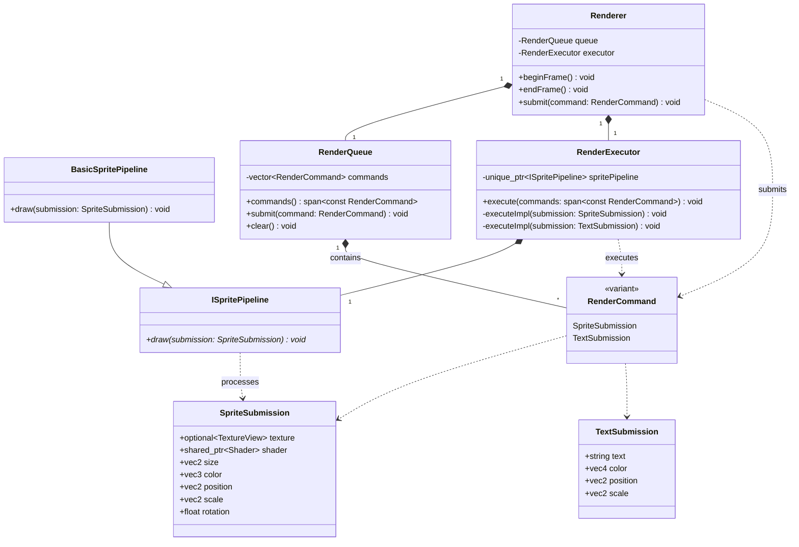

# StarfighterAlliance - Rendering

## Problem

The problem is the current rendering implementation. There is a renderer for each specific renderable, which while
being functional is not really convenient to use neither very maintainable. 

## Solution

A better approach would be to implement rendering using a render queue system. The render queue system would not only
make it more convenient to interact with the rendering API but also would allow for easier addition of new renderables.
In the long term it also provides a better chance for extensibility and performance scaling because of techniques like
batching and render passes.

## Architecture

